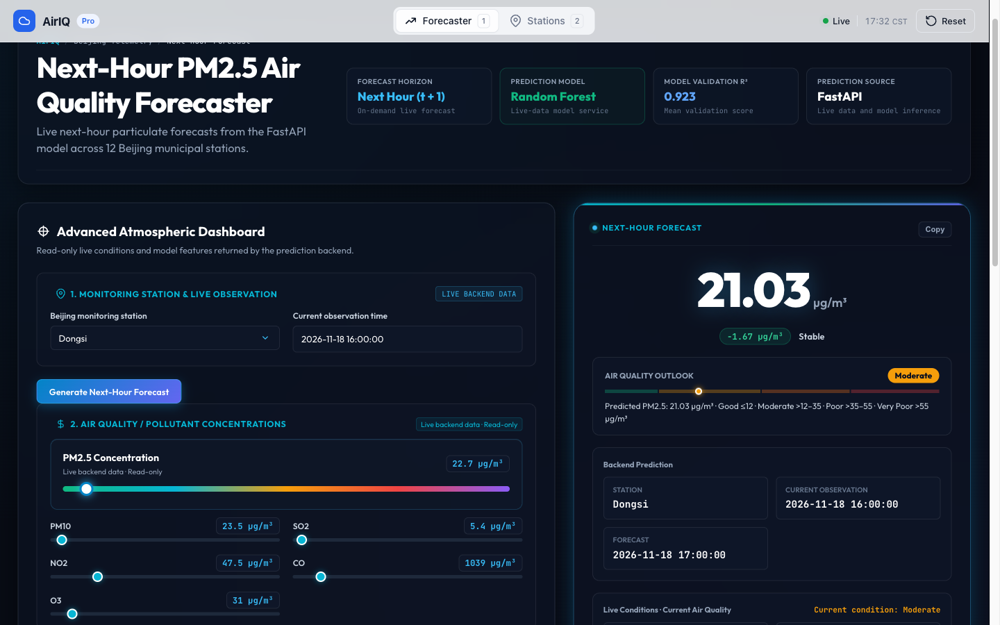
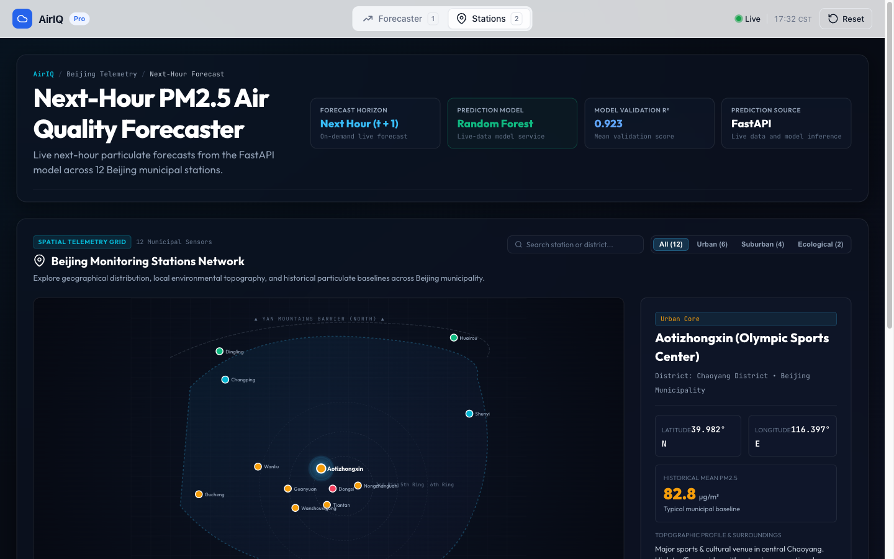
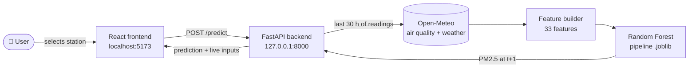

<div align="center">

# 🌫️ AirIQ

### Next-hour PM2.5 air-quality forecasting for Beijing

Pick a monitoring station and get a machine-learning forecast of fine-particle pollution one hour ahead, built from live air-quality and weather data.

[](https://www.python.org/)
[](https://fastapi.tiangolo.com/)
[](https://scikit-learn.org/)
[](https://react.dev/)
[](https://www.typescriptlang.org/)
[](https://vite.dev/)
[](LICENSE)



</div>

---

## 📑 Table of Contents

- [About the Project](#-about-the-project)
- [Key Features](#-key-features)
- [How It Works](#️-how-it-works)
- [Model Performance](#-model-performance)
- [Tech Stack](#-tech-stack)
- [Project Structure](#-project-structure)
- [Getting Started](#-getting-started)
- [Using the App](#️-using-the-app)
- [API Reference](#-api-reference)
- [Reproducing the ML Pipeline](#-reproducing-the-ml-pipeline)
- [Troubleshooting](#️-troubleshooting)
- [FAQ](#-faq)
- [Limitations](#️-limitations)
- [Team & Credits](#-team--credits)
- [License](#-license)

---

## 📖 About the Project

**PM2.5** (fine particulate matter, particles ≤ 2.5 µm) is one of the most harmful air pollutants, and its level can change noticeably from one hour to the next. **AirIQ answers a simple question:** *what will the PM2.5 concentration be at this station in the next hour?*

It does this in three steps:

1. **Fetches live data** — current pollutant and weather readings for the chosen station from the free [Open-Meteo](https://open-meteo.com/) APIs.
2. **Builds model features** — turns the last ~30 hours of readings into the same 33 features the model was trained on (lags, rolling averages, time-of-day, season, …).
3. **Predicts** — a Random Forest regression model returns the forecast PM2.5 value (µg/m³) for the next hour.

The model was developed through a complete data-mining workflow on the
[Beijing Multi-Site Air Quality dataset](https://archive.ics.uci.edu/dataset/501/beijing+multi+site+air+quality+data)
(420,768 hourly records from 12 stations, 2013–2017) as part of the **IT3051 – Fundamentals of Data Mining** module.

> **Who is it for?** Students and developers learning end-to-end ML systems, environmental-data analysts, and anyone curious about short-term air-quality forecasting.

---

## ✨ Key Features

| | Feature | Description |
|---|---|---|
| 🔮 | **Next-hour forecast** | One-click PM2.5 prediction for any of the 12 Beijing monitoring stations |
| 📡 | **Live data** | Current PM2.5, PM10, SO₂, NO₂, CO, O₃, temperature, pressure, dew point, rain, and wind — no API key required |
| 🚦 | **Air-quality outlook** | Forecast classified as *Good* (≤12), *Moderate* (>12–35), *Poor* (>35–55) or *Very Poor* (>55 µg/m³), with the change from the current hour |
| 📈 | **Transparent inputs** | Shows the exact historical features the model used: 1–24 h lags, rolling means, and rolling standard deviations |
| 🗺️ | **Station explorer** | Interactive map of all 12 stations with search, Urban / Suburban / Ecological filters, coordinates, and historical average PM2.5 |
| 📋 | **Copy summary** | Copy the forecast to the clipboard in one click |
| 🔌 | **REST API** | FastAPI backend with interactive Swagger docs at `/docs` |
| 🔬 | **Reproducible research** | 13 Jupyter notebooks covering the full pipeline, from raw data to the final model |

<div align="center">

<br><sub><i>The Stations tab: explore all 12 monitoring sites and load one into the forecaster.</i></sub>
</div>

---

## ⚙️ How It Works



| Step | Where in the code |
|---|---|
| Station list & coordinates | [`backend/config/station_coordinates.py`](backend/config/station_coordinates.py) |
| Live data → features | [`backend/services/live_features.py`](backend/services/live_features.py) |
| Model loading & prediction | [`backend/services/predictor.py`](backend/services/predictor.py) |
| API endpoints | [`backend/main.py`](backend/main.py) |
| Frontend API client | [`frontend/src/services/inferenceEngine.ts`](frontend/src/services/inferenceEngine.ts) |
| Custom ML transformers | [`src/modeling_utils.py`](src/modeling_utils.py) |

---

## 📊 Model Performance

Four algorithms were compared using **expanding-window (walk-forward) validation** across 2014, 2015, and 2016, so the model never trains on data from the future.

| Model | Mean MAE | Mean RMSE | Mean R² |
|---|---:|---:|---:|
| Linear Regression | 13.28 | 26.36 | 0.891 |
| Decision Tree | 13.73 | 26.30 | 0.891 |
| **Random Forest** ✅ | **10.65** | **22.11** | **0.923** |
| HistGradientBoosting | 10.69 | 22.32 | 0.922 |

**Final test** on the untouched Jan–Feb 2017 hold-out: **MAE 14.74 · RMSE 34.13 · R² 0.912** µg/m³.

> [!NOTE]
> A simple *persistence* baseline ("next hour = this hour") reached a lower validation RMSE (~18.97) than the models above. Random Forest is the **best machine-learning model** evaluated, not a model that beats persistence. All metrics come from the 2013–2017 historical data, **not** from live predictions.

The full methodology (EDA, preprocessing, feature experiments, tuning) is in [`docs/methodology.md`](docs/methodology.md) and the [technical report](docs/technical-report.pdf).

---

## 🧰 Tech Stack

| Layer | Technologies |
|---|---|
| **Machine learning** | scikit-learn 1.9.1 (Random Forest pipeline), pandas, NumPy, joblib |
| **Backend** | Python, FastAPI, Uvicorn, Pydantic, Requests |
| **Frontend** | React 19, TypeScript, Vite 8, Oxlint |
| **Live data** | Open-Meteo Air Quality API + Forecast API (free, no key) |
| **Research** | Jupyter notebooks, matplotlib |

---

## 📁 Project Structure

```text
AirIQ/
├── backend/                        # FastAPI prediction API
│   ├── config/station_coordinates.py
│   ├── services/
│   │   ├── live_features.py        # Open-Meteo data → 33 model features
│   │   └── predictor.py            # loads the model, makes the prediction
│   ├── model/                      # put final_pm25_pipeline.joblib here
│   └── main.py                     # API entry point
├── frontend/                       # React + TypeScript dashboard
│   ├── src/components/             # Forecaster tab, Stations tab, header, …
│   ├── src/services/inferenceEngine.ts
│   └── package.json
├── src/                            # shared ML code + project paths
│   ├── modeling_utils.py           # ⚠️ required to load the model
│   └── project_config.py
├── notebooks/                      # 00–12: full data-mining pipeline
├── PRSA_Data_20130301-20170228/    # original UCI dataset (12 CSVs)
├── docs/                           # report, presentation, methodology, images
├── requirements.txt
└── LICENSE
```

> [!IMPORTANT]
> Keep `src/` at the repository root. The saved model references `src.modeling_utils`, so moving or renaming it will stop the model from loading.

---

## 🚀 Getting Started

### Prerequisites

Install these first:

| Software | Version | Check with |
|---|---|---|
| [Python](https://www.python.org/downloads/) | 3.11 or newer | `python3 --version` (Windows: `python --version`) |
| [Node.js](https://nodejs.org/) (includes npm) | 20.19+ or 22.12+ | `node --version` |
| [Git](https://git-scm.com/downloads) | any recent | `git --version` |

You'll also need about **1.5 GB of free disk space**, about **1 GB of free RAM** (the model uses ~830 MB in memory), and an **internet connection** for live data.

### 1. Clone the repository

```bash
git clone https://github.com/<your-username>/<repository-name>.git
cd <repository-name>
```

> No Git? On the GitHub page, click **Code → Download ZIP**, extract it, and open a terminal in the extracted folder.

### 2. Download the trained model

The model file is ~840 MB, which is too large to store in Git, so it's attached to a GitHub Release.

1. Open the [**latest release**](../../releases/latest).
2. Download **`final_pm25_pipeline.joblib`**.
3. Move it into the `backend/model/` folder:

```text
backend/model/final_pm25_pipeline.joblib
```

### 3. Set up and start the backend

From the **project root folder**, create a virtual environment and install the Python packages:

<details open>
<summary><b>macOS / Linux</b></summary>

```bash
python3 -m venv .venv
source .venv/bin/activate
pip install -r requirements.txt
python -m uvicorn backend.main:app --reload
```
</details>

<details>
<summary><b>Windows (PowerShell)</b></summary>

```powershell
python -m venv .venv
.venv\Scripts\Activate.ps1
pip install -r requirements.txt
python -m uvicorn backend.main:app --reload
```

If PowerShell says *"running scripts is disabled on this system"*, use Command Prompt and activate with `.venv\Scripts\activate.bat` instead. If `python` isn't recognised, try `py`.
</details>

The model loads in a few seconds, and then you should see:

```text
INFO:     Uvicorn running on http://127.0.0.1:8000 (Press CTRL+C to quit)
```

✅ Check it: open **http://127.0.0.1:8000/docs** to see the interactive API docs.

### 4. Set up and start the frontend

Open a **second terminal** in the project root (leave the backend running):

```bash
cd frontend
npm install
npm run dev
```

### 5. Open the app

Go to **👉 http://localhost:5173**

### 6. Stop the app

Press **`Ctrl + C`** in each terminal. To leave the Python virtual environment, run `deactivate`.

> **Environment variables:** none are needed. Open-Meteo is free and doesn't require an API key. The ports are fixed: backend `8000`, frontend `5173`.

---

## 🖱️ Using the App

### Get a forecast

1. Open **http://localhost:5173**. The **Forecaster** tab opens by default.
2. Choose a station from the **Beijing monitoring station** dropdown (for example, *Dongsi*).
3. Click **Generate Next-Hour Forecast**.
4. After a couple of seconds, the right-hand panel shows:
   - the **predicted PM2.5** for the next hour (e.g. `21.03 µg/m³`), plus how much it differs from the current reading;
   - the **Air Quality Outlook** badge (*Good / Moderate / Poor / Very Poor*);
   - the **current observation time** and **forecast time** (Beijing time);
   - the live **air-quality** and **weather** readings and the **historical PM2.5 features** the model used.
5. Click **Copy** to copy a text summary, or **Reset** (top right) to start over.

### Explore the stations

1. Click the **Stations** tab.
2. Use the search box (station or district) or the **Urban / Suburban / Ecological** filters.
3. Click a station on the map to see its location, district, and historical average PM2.5.
4. Click **Load into Forecaster** to forecast for that station.

---

## 🔌 API Reference

Base URL: `http://127.0.0.1:8000` · Interactive docs: [`/docs`](http://127.0.0.1:8000/docs)

| Method | Endpoint | Description |
|---|---|---|
| `GET` | `/` | Health check |
| `GET` | `/stations` | List the 12 supported station names |
| `POST` | `/predict` | Next-hour PM2.5 forecast for one station |

**Example**

```bash
curl -X POST http://127.0.0.1:8000/predict \
     -H "Content-Type: application/json" \
     -d '{"station": "Dongsi"}'
```

<details>
<summary>Example response</summary>

```json
{
  "station": "Dongsi",
  "current_time": "2026-11-18 16:00:00",
  "predicted_time": "2026-11-18 17:00:00",
  "predicted_pm25": 21.03,
  "unit": "µg/m³",
  "air_quality": { "PM2_5": 22.7, "PM10": 23.5, "SO2": 5.4, "NO2": 47.5, "CO": 1039.0, "O3": 31.0 },
  "weather": { "TEMP": 5.8, "PRES": 1020.3, "DEWP": -13.2, "RAIN": 0.0, "WSPM": 14.3, "wd": "NW" },
  "historical_features": {
    "PM2_5_lag_1h": 19.0, "PM2_5_lag_2h": 18.4, "PM2_5_lag_3h": 17.3,
    "PM2_5_lag_6h": 18.4, "PM2_5_lag_12h": 3.8, "PM2_5_lag_24h": 81.5,
    "PM2_5_roll_mean_3h": 18.23, "PM2_5_roll_mean_6h": 17.77, "PM2_5_roll_mean_24h": 54.02,
    "PM2_5_roll_std_6h": 0.96, "PM2_5_roll_std_24h": 62.99
  }
}
```
</details>

| Status | When |
|---|---|
| `200` | Success |
| `400` | Empty or unknown station name |
| `500` | Prediction failed (for example, Open-Meteo couldn't be reached) |

---

## 🔬 Reproducing the ML Pipeline

The [`notebooks/`](notebooks/) folder rebuilds everything from the original dataset, which is included in [`PRSA_Data_20130301-20170228/`](PRSA_Data_20130301-20170228/).

```bash
source .venv/bin/activate              # Windows: .venv\Scripts\Activate.ps1
pip install jupyter matplotlib
jupyter notebook notebooks/
```

Run them **in order**, from `00` to `12`:

| # | Notebook | # | Notebook |
|---|---|---|---|
| 00 | Dataset integration | 07 | Persistence baseline |
| 01 | Dataset verification | 08 | Model training (4 algorithms) |
| 02 | Exploratory data analysis | 09 | Model comparison |
| 03 | Target construction | 10 | Feature-group experiments |
| 04 | Preprocessing | 11 | Hyperparameter tuning |
| 05 | Feature engineering | 12 | Final model selection & test |
| 06 | Walk-forward data split | | |

Generated files are written to `data/` (git-ignored). Notebook 12 saves a new model to `data/results/final_pm25_pipeline.joblib`. To use it in the app, copy it into `backend/model/`.

> [!TIP]
> Notebooks 00–07 finish in about 2 minutes. Notebooks 08–12 train many Random Forest models and take much longer.

---

## 🛠️ Troubleshooting

<details>
<summary><b><code>FileNotFoundError</code> … <code>final_pm25_pipeline.joblib</code></b></summary>

The model hasn't been downloaded or is in the wrong place. Follow [step 2](#2-download-the-trained-model) and make sure the path is exactly `backend/model/final_pm25_pipeline.joblib`.
</details>

<details>
<summary><b><code>ModuleNotFoundError: No module named 'backend'</code> (or <code>'src'</code>)</b></summary>

Start the backend from the **project root**, not from inside `backend/`:
```bash
python -m uvicorn backend.main:app --reload
```
</details>

<details>
<summary><b>The app says "Unable to connect to the prediction server"</b></summary>

The backend isn't running, or it isn't on port 8000. Start it ([step 3](#3-set-up-and-start-the-backend)) and check that http://127.0.0.1:8000 responds.
</details>

<details>
<summary><b>Requests are blocked by CORS / the frontend opened on port 5174</b></summary>

If port 5173 is busy, Vite automatically switches to another port, but the backend only accepts requests from `localhost:5173` and `127.0.0.1:5173`. Close whatever is using port 5173 and run `npm run dev` again.
</details>

<details>
<summary><b><code>500 Prediction failed</code></b></summary>

The backend couldn't get live data from Open-Meteo. Check your internet connection and try again in a moment.
</details>

<details>
<summary><b>scikit-learn version warnings or errors when loading the model</b></summary>

The model was saved with **scikit-learn 1.9.1**. Reinstall with `pip install -r requirements.txt` inside the virtual environment, which pins that version.
</details>

<details>
<summary><b>Notebook error: "Run 00_dataset_integration.ipynb first."</b></summary>

The notebooks depend on each other. Run them in numerical order, starting with `00`.
</details>

---

## ❓ FAQ

**Do I need an API key?**
No. Open-Meteo is free for non-commercial use and doesn't need a key.

**Is the forecast accurate for today's air quality?**
The reported metrics come from the 2013–2017 historical dataset. Live predictions use Open-Meteo data, which comes from a different source, so live accuracy hasn't been measured. See [Limitations](#️-limitations).

**Why do nearby stations sometimes show identical live readings?**
Open-Meteo provides modelled data on a grid. Stations close to each other (for example, in central Beijing) can fall into the same grid cell and receive the same inputs. Their forecasts then differ only slightly, because the model also uses the station identity.

**Can I use it for other cities?**
Not as-is. The model was trained only on these 12 Beijing stations.

**Can I retrain the model?**
Yes. See [Reproducing the ML Pipeline](#-reproducing-the-ml-pipeline).

---

## ⚠️ Limitations

- Trained on historical **2013–2017** data, while live inputs come from **Open-Meteo**, so the two sources may differ in distribution.
- Reported metrics reflect the historical test period, **not** measured live performance.
- Forecasts only **one hour ahead**.
- Station coordinates are mappings used to query Open-Meteo; live values are grid-based, not readings from the physical monitors.

---

## 👥 Team & Credits

Built by **Data Seekers** for *IT3051 – Fundamentals of Data Mining* (Mini Project 2026):

- Eththiligoda Gamage Nethum Pabasara
- Wanekotuwe Gedara Ruchira Dilshan Kotuwegedara
- Madduma Ralalage Sithumini Nirasha Ganegoda
- Kulani Sandamila Hettiarachchi

📄 Project documents: [Technical report](docs/technical-report.pdf) · [Presentation](docs/presentation.pptx) · [Dataset proposal](docs/dataset-proposal.pdf) · [Methodology](docs/methodology.md)

**Dataset:** Chen, S. (2017). *Beijing Multi-Site Air Quality* [Dataset]. UCI Machine Learning Repository. https://doi.org/10.24432/C5RK5G. See [`docs/dataset/`](docs/dataset/) for the data dictionary and full citation.

**Live data:** [Open-Meteo](https://open-meteo.com/) Air Quality and Weather Forecast APIs.

---

## 📄 License

The code is released under the [MIT License](LICENSE).
The dataset in `PRSA_Data_20130301-20170228/` belongs to its original authors and is licensed under CC BY 4.0.
